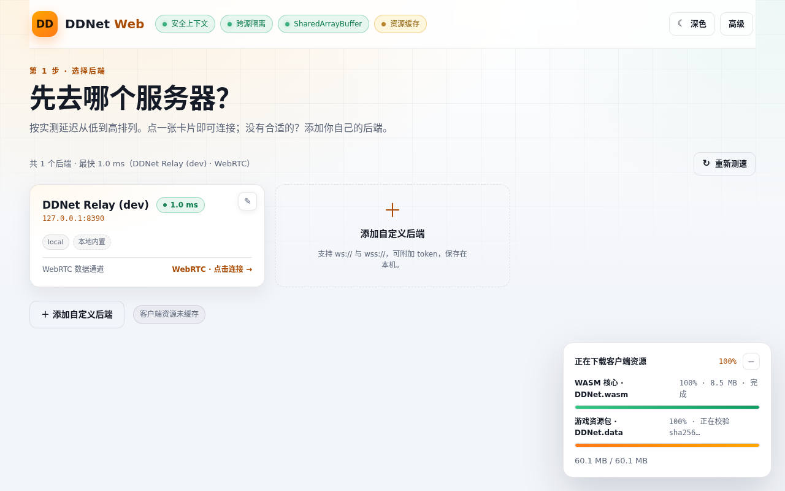
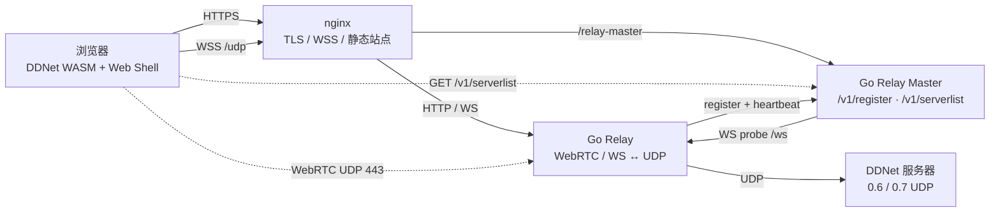

# 🎮 DDNet Web — 浏览器 DDNet 客户端、WebRTC 中继与 Relay Master

**在浏览器里运行真正的 DDNet（C++ → WebAssembly），通过 WebRTC DataChannel / WebSocket 连接自建中继，再由中继转发到任意原版 DDNet 服务器。自带 relay master 节点注册中心、官方服务器列表、移动端触屏 UI 和生产 nginx 部署方案。**

[](https://go.dev/)
[](https://emscripten.org/)
[](https://webrtc.org/)
[](https://developer.mozilla.org/docs/Web/API/WebSocket)
[](https://www.docker.com/)
[](https://nginx.org/)
[](#-development--verification)

*在浏览器里玩 DDNet 0.6/0.7；游戏流量优先走 WebRTC DataChannel，失败自动回退 WebSocket；relay master 负责节点注册、首次 WS 验证和 15 分钟存活检查。*

**文档：** [快速开始](docs/QUICKSTART.md) · [架构与约定](AGENTS.md) · [生产 nginx](deploy/README.md) · [前端说明](web/README.md) · [Go relay](relay-go/README.md)



*后端选择页：延迟排序、WebRTC/WS 传输状态、relay master 节点、亮色/深色主题。*

[Overview](#-overview) • [Features](#-key-features) • [Supported Environments](#-supported-environments) • [Quick Start](#-quick-start) • [Connect & API](#-connect--api) • [Architecture](#-architecture) • [Configuration](#-configuration) • [Security](#-security--reliability) • [Verification](#-development--verification)

---

## 📖 Overview

**DDNet Web** 把上游 DDNet 的 C++ 客户端编译成 WebAssembly，在浏览器里保留完整渲染、音频、配置、服务器浏览器和输入逻辑。网络层新增了浏览器可用的传输：

- **WebRTC DataChannel（首选）**：UDP 语义的 `ordered:false, maxRetransmits:0`，适合游戏数据报；
- **WebSocket（回退）**：1 个二进制帧 = 1 个 UDP 数据报，兼容现有中继与严格网络环境；
- **relay master**：中继节点向中心注册，master 主动 WS 验证并通过 `/v1/serverlist` 下发健康节点；
- **生产入口**：Go 中继只讲明文 HTTP/WS，TLS/WSS/静态站点全部交给 nginx。

浏览器只连接自建中继，不直接访问游戏服务器；中继再把 UDP 数据报发给任意 DDNet 0.6/0.7 服务器。服务端零修改。

---

## ✨ Key Features

### 客户端与游戏体验

- **真正的 DDNet 客户端**：上游 C++ 代码 → Emscripten/WASM，WebGL2 渲染、音频、配置、Demo/服务器浏览器均保留。
- **DDNet 0.6 / 0.7**：支持 `tw-0.7+udp://` 地址；游戏内浏览器拿到的纯 UDP 地址会经中继改写，0.7 自动追加 `?protocol=7`。
- **官方服务器列表**：直接读取 DDNet master1–4 的全量服务器（约 1400 台），支持搜索、协议/类型/地区筛选、隐藏满员/密码房、按玩家数/名称/地区排序与分页。
- **WebRTC 优先、WS 回退**：中继不可用或 ICE 失败时自动回退 WebSocket；可通过 `?transport=ws` 强制 WebSocket。
- **桌面与移动端**：桌面 Pointer Lock / ESC 菜单光标；移动端内置触屏控件、触屏引导和全屏按钮；触屏笔记本/Windows 触控显示器仍按桌面处理。
- **中文输入法 / 剪贴板**：隐藏 textarea 桥接 IME，支持中文组合输入、粘贴、复制、剪切。
- **性能细节**：Tab 计分板/ESC 菜单隐藏网页浮层、抑制按键 auto-repeat、Emscripten 强制 `Inactive=false`；聚光灯使用四块遮罩而不是整屏 `box-shadow`。

### 传输与中继

- **WebRTC DataChannel**：浏览器与中继之间直接建立 UDP/DTLS 数据通道，中继通过 `POST /rtc/offer` 完成非 trickle 信令。
- **WebSocket 回退**：`ws[s]://relay/udp/<host>:<port>[?token=...&protocol=7]`，每帧对应一个 UDP 数据报。
- **固定共享 UDP 端口**：所有 WebRTC peer 共用同一 `ice.UDPMuxDefault`，不会按用户分配 UDP 端口；TCP(WS) 与 UDP(ICE) 默认同号（开发 `8390`，生产 `443`）。
- **relay master**：`/v1/register` 首次注册时主动对 `<relay>/ws` 做 RFC6455 握手验证，失败返回 502；之后每 15 分钟复检，失败节点立即从列表移除。
- **WebRTC 元数据声明**：注册报文包含 `transports` 和 `webrtc:{enabled,host,signalUrl,udpPort}`，master 会校验 host 与固定端口。
- **token relay 不注册**：配置了 `RELAY_TOKENS` 的 relay 自动跳过 master 注册，避免私有节点泄露到公共列表。

### 前端与运维

- **零构建前端**：原生 ESM，HTML/CSS/JS 直接部署；资源下载带 sha256 校验与 Cache Storage。
- **相对 master base**：前端默认请求同源 `/relay-master/v1/serverlist`；生产只改 nginx 反代，无需重构建。
- **可观测性**：`/api/info`、`/api/stats`、`/healthz`、master `/api/stats`，HUD 显示 WebRTC/WS 传输方式和流量。
- **生产部署无 Caddy**：`compose.yml` 只启动 Go relay + relay master（回环端口），TLS/WSS/静态站点由 nginx 终止。
- **完整 compose**：开发、测试、生产分离；WebRTC 回退、空闲重连、IME/剪贴板、桌面/移动端均有 E2E。

---

## 🎯 Supported Environments

| 项 | 支持情况 |
|---|---|
| DDNet 协议 | 0.6 / 0.7（sixup） |
| 浏览器 | Chromium 系（E2E 覆盖）；需要 WebGL2、WebAssembly、SharedArrayBuffer |
| 游戏传输 | WebRTC DataChannel（首选）/ WebSocket（回退） |
| 桌面 | Pointer Lock、ESC 菜单光标、Tab 计分板、IME、剪贴板 |
| 移动端 | 触屏控件、触屏引导、全屏按钮（Android/平板浏览器） |
| 中继节点 | Go 1.24，单二进制/容器；WebRTC + WS + UDP |
| relay master | Go 1.24；HTTP API + 主动 WS 探测 + 15 分钟健康检查 |
| 生产入口 | nginx（TLS/WSS/静态站点/反代）；relay 只讲 HTTP/WS |
| 构建 | Emscripten 4.0.22 + Rust 1.89 + Docker wasm builder |
| 测试 | Go 79 项、前端 Node 82 项、Chromium E2E 89 项 |

---

## 🚀 Quick Start

### Requirements

- **Option A（推荐，试用/开发）**：Docker + Docker Compose。无需在宿主安装 Go、Node、Emscripten。
- **Option B（生产）**：Docker + nginx + 公网域名/证书；静态站点由 nginx 直接服务。
- **Option C（开发 wasm）**：Docker + 本地上游 DDNet 源码/worktree，用于重新编译 wasm。

> 浏览器访问非 localhost 页面时需要 HTTPS 才能使用 SharedArrayBuffer；开发栈自带自签 8443 端口，生产由 nginx 提供有效证书。

### Option A — 一键开发栈（推荐先跑起来）

```bash
cd /root/test
./scripts/dev-up.sh
```

默认启动 4 个容器：

| 服务 | 地址 | 说明 |
|---|---|---|
| `relay` | `127.0.0.1:8390`（TCP+UDP） | Go 中继，自动注册到本机 master |
| `relay-master` | `127.0.0.1:8391` | 节点注册中心 |
| `web-http` | `http://127.0.0.1:8392` | 本机 HTTP 站点（localhost 是安全上下文） |
| `web-https` | `https://<LAN-IP>:8443` | 自签 HTTPS + WSS + `/relay-master` 反代 |

打开：

```text
http://localhost:8392/
# 或局域网（先接受自签证书）
https://<LAN-IP>:8443/
```

首次会下载 `DDNet.wasm`（约 8.5 MB）和 `DDNet.data`（约 51.6 MB），校验后写入浏览器 Cache Storage。默认游戏服务器是 DDNet 官方 Tutorial，本机不需要启动游戏服务器。

> 开发 HTTPS 需要 `ws` 依赖（`tests/node_modules`）：
>
> ```bash
> npm --prefix tests install
> ```

### Option B — 生产部署（nginx 终止 TLS）

```bash
RELAY_DOMAIN=play.example.com \
RELAY_PUBLIC_URL=wss://play.example.com \
MASTER_DOMAIN=master.landmine.top \
RELAY_ORIGINS=https://play.example.com \
RTC_PUBLIC_IP=<公网IP> \
docker compose -f compose.yml up -d --build
```

然后把 [deploy/nginx.conf](deploy/nginx.conf) 安装到生产 nginx，按实际域名、证书和 `dist/web` 路径修改：

```bash
sudo cp deploy/nginx.conf /etc/nginx/conf.d/ddnet-web.conf
sudo nginx -t
sudo systemctl reload nginx
```

生产端口：

```text
TCP 443  nginx：站点 + WSS + /relay-master
UDP 443  relay：WebRTC ICE（与 nginx TCP 443 同号）
```

防火墙放行 **TCP 443 + UDP 443**。如果 relay 在 NAT 后，设置 `RTC_PUBLIC_IP`；需要跨 NAT 时配置 `RTC_ICE_SERVERS`（STUN/TURN）。

> 设置 `RELAY_TOKENS` 后 relay 不会注册到 master；希望出现在公共 master 列表时请不要设置 token。

### Option C — 重新构建 WASM

```bash
cd build
BUILD_TYPE=Release ./build-wasm.sh     # 约 1.5 分钟，产物进 dist/web

cd ..
scripts/assemble-web.sh                # 组装前端 + manifest.json（改前端后必须重跑）
```

`build-wasm.sh` 默认源码路径是本地 `ddnet-dev/`；上游基线 `ddnet/` 和 worktree `ddnet-dev/` 不纳入本仓库，补丁见 [patches/ddnet-web-client.patch](patches/ddnet-web-client.patch)。

### First Start

- **开发**：`./scripts/dev-up.sh` 会等待健康检查；master 列表：

  ```bash
  curl http://127.0.0.1:8391/v1/serverlist
  ```

- **生产**：`docker compose -f compose.yml up -d --build` 后访问 nginx 站点；
  健康检查：

  ```bash
  curl https://play.example.com/healthz
  curl https://master.landmine.top/v1/serverlist
  ```

- 游戏内 **Ctrl + 反引号键（\`）** 切换后端连接信息 HUD；首次进入会显示聚光灯引导。

---

## 🔌 Connect & API

### 浏览器入口

| 地址 | 用途 |
|---|---|
| `http://localhost:8392/` | 开发 HTTP 站点 |
| `https://<LAN-IP>:8443/` | 开发 HTTPS + WSS |
| `https://play.example.com/` | 生产站点 |
| `https://play.example.com/relay-master/v1/serverlist` | 同源 master 列表 |
| `https://master.landmine.top/v1/serverlist` | master 直连列表 |

前端 master base 可用以下方式覆盖：

```html
<meta name="relay-master-base" content="/relay-master">
```

```js
window.DDWEB_MASTER_BASE = '/api/relay-master';
```

```text
?masterBase=/relay-master
?master=https://master.example.com/v1/serverlist
```

### 连接地址

```text
wss://play.example.com/udp/<host>:<port>?token=<t>&protocol=7
```

- `protocol=7`（也接受 `protocol=0.7` / `sevenup=1` / `tw7=1`）→ DDNet 0.7 sixup
- WebRTC 优先：浏览器先 `POST /rtc/offer?target=host:port`，约 6 秒未建立则回退 WS
- 强制 WS：连接 URL 增加 `?transport=ws`

### Relay 注册报文

```json
{
  "name": "DDNet Relay",
  "url": "wss://play.example.com",
  "region": "EU",
  "version": "1.0.0",
  "players": 0,
  "transports": ["websocket", "webrtc"],
  "webrtc": {
    "enabled": true,
    "host": "play.example.com",
    "signalUrl": "https://play.example.com/rtc/offer",
    "udpPort": 443
  }
}
```

master 首次注册会主动请求 `<url>/ws` 验证；`webrtc.host` 是 UDP 入口的域名/IP，`udpPort` 是固定共享端口。

---

## 🏗 Architecture



- **浏览器**只接触 nginx；WebRTC 媒体/数据通道直接到 relay UDP。
- **relay** 负责 WS ↔ UDP、WebRTC ↔ UDP、鉴权/SSRF/限流/统计。
- **master** 负责注册、首次 WS 验证、15 分钟健康检查和节点列表。
- **游戏服务器**保持原版 DDNet，无任何修改。

---

## ⚙️ Configuration

### Relay

| 变量 | 默认 | 说明 |
|---|---|---|
| `RELAY_HOST` / `RELAY_PORT` | `0.0.0.0` / `8390`（镜像） | HTTP/WS 监听 |
| `RELAY_TOKENS` | 空 | 逗号分隔的访问 token；设置后 relay 跳过 master 注册 |
| `RELAY_ORIGINS` | 空 | 允许的浏览器 Origin；生产必填 |
| `ALLOW_PRIVATE` | `false`（生产） | 是否允许私网 UDP 目标 |
| `RELAY_ALLOWLIST` | 空 | 目标 host/IP/CIDR 白名单 |
| `RTC_ENABLED` | `true` | 是否启用 WebRTC |
| `RTC_UDP_PORT` | 跟随 relay TCP 端口（生产 compose 为 `443`） | 固定共享 ICE UDP 端口 |
| `RTC_PUBLIC_IP` | 空 | NAT 后通告的公网 IP |
| `RTC_ICE_SERVERS` | 空 | STUN/TURN URL 列表 |
| `RELAY_MASTER_DOMAIN` | `https://master.landmine.top` | master 地址 |
| `RELAY_MASTER_ADVERTISE_URL` | `wss://$RELAY_DOMAIN`（生产 compose） | 注册到 master 的公网 relay URL |
| `RELAY_MASTER_INTERVAL_MS` | `30000` | 注册/心跳间隔 |

### Relay Master

| 变量 | 默认 | 说明 |
|---|---|---|
| `MASTER_HOST` / `MASTER_PORT` | `0.0.0.0` / `8391` | master HTTP 监听 |
| `MASTER_PROBE_INTERVAL_MS` | `900000` | 存活检查间隔（15 分钟） |
| `MASTER_PROBE_TIMEOUT_MS` | `5000` | 单节点 WS 探测超时 |
| `MASTER_REGISTER_PER_MINUTE` | `30` | 单 IP 注册频率限制 |
| `MASTER_MAX_NODES` | `1000` | 最大注册节点数 |
| `MASTER_CORS_ORIGINS` | `*` | `/v1/serverlist` CORS |

### Frontend

| 配置 | 说明 |
|---|---|
| `<meta name="relay-master-base">` | 默认 `/relay-master`，可改同源路径 |
| `window.DDWEB_MASTER_BASE` | 运行时覆盖 base |
| `?masterBase=<base>` | URL 覆盖 base |
| `?master=<full endpoint>` | 覆盖完整 serverlist 地址 |

---

## 📚 API Surface

### Relay

| Method | Path | 说明 |
|---|---|---|
| `WS` | `/udp/<host>:<port>[?token=&protocol=7]` | 游戏 WebSocket 隧道（1 帧 = 1 UDP 数据报） |
| `WS` | `/ws` | master 健康探测升级端点 |
| `POST` | `/rtc/offer` | WebRTC 信令；带 `target` 时桥接游戏 DataChannel，不带时为延迟回显 |
| `GET` | `/api/info` | relay 名称、协议、RTC、ICE 配置、连接数 |
| `GET` | `/api/servers` | 推荐服务器列表 |
| `GET` | `/api/stats` | 会话/目标/流量统计 |
| `GET` | `/healthz` | 健康检查 |

### Relay Master

| Method | Path | 说明 |
|---|---|---|
| `POST` | `/v1/register` | relay 注册；首次注册主动 WS 验证 |
| `POST` | `/v1/unregister` | 移除节点（relay 退出时尽力调用） |
| `GET` | `/v1/serverlist` | 已验证且 healthy 的节点列表，CORS 默认 `*` |
| `GET` | `/healthz` | master 健康检查 |
| `GET` | `/api/stats` | 节点数、探测配置 |

---

## 🛡️ Security & Reliability

- **TLS 只在 nginx**：Go relay 不实现 TLS；生产 compose 只绑定 `127.0.0.1:8080/8081`，避免绕过 nginx。
- **relay 鉴权**：`RELAY_TOKENS` + `RELAY_ORIGINS`；生产默认 `RELAY_ALLOW_NO_ORIGIN=false`。
- **SSRF 防护**：默认禁止私网/回环目标；通过 `ALLOW_PRIVATE` / `RELAY_ALLOWLIST` 显式放行。
- **限流**：每 IP 连接数、总连接数、帧大小、包/字节速率、RTC offer 限流。
- **master 验证**：首次注册 WS 握手验证 + 15 分钟复检；不健康的 relay 自动移除。
- **固定 UDP 入口**：所有 WebRTC peer 共用 `ice.UDPMuxDefault` 的同一 UDP 端口；master 拒绝 `webrtc.enabled=true && udpPort=0`。
- **token relay 不注册**：避免私有 relay 出现在公共 master 列表。
- **自签证书**：只建议内网测试；浏览器仍会校验证书，跨域名/端口需要单独信任，正式环境使用 nginx + 公网证书。
- **master 注册表是内存态**：master 重启后依赖 relay 30 秒心跳重新注册；公开注册只有 IP 限流 + 节点数上限。

---

## 🧪 Development & Verification

### 后端 Go

```bash
docker compose -f compose.test.yml --profile test run --rm relay-unit
```

覆盖 WebSocket↔UDP、WebRTC↔UDP、鉴权、SSRF、限流、master 注册/探测/健康检查、WebRTC 固定端口等。

### 前端 Node

```bash
cd web
node tools/test-pure.mjs
node tools/test-assets.mjs
node tools/test-latency.mjs
node tools/test-dom.mjs
node tools/test-integration.mjs
```

### Chromium E2E

先启动确定性本地服务器：

```bash
docker compose -f compose.test.yml --profile local-server up -d ddnet-server-local
docker compose -f compose.test.yml --profile test run --rm -T \
  -e TARGET=127.0.0.1:8313 e2e-web
```

覆盖：资源下载、后端选择、服务器列表、进游戏、聚光灯、移动端、桌面触控 PC、IME/剪贴板、WebRTC 传输、relay master 发现。

### 当前验证结果

| 项目 | 结果 |
|---|---|
| Go 后端测试 | ✅ 79 项 |
| 前端 Node 测试 | ✅ 82 项（纯函数 41 + 资源 8 + 延迟 11 + DOM 16 + 集成 6） |
| Chromium E2E | ✅ 89/89 |
| WebRTC 同端口传输 | ✅ 5/5 |
| relay master 注册/拒绝/网页发现 | ✅ 6/6 |
| wasm 中文 IME / 剪贴板 | ✅ 11/11 |
| 生产 nginx 语法 | ✅ `nginx -t`（临时证书） |
| 生产 compose | ✅ `docker compose config` + 镜像构建 |

> 完整 E2E 合计 89 项；`rtc_transport`、`master_discovery`、`ime_clipboard` 等子套件均包含在内。

---

## 📁 Project Layout

```text
web/                   前端 Shell（原生 ESM）+ Node 测试 + wasm 资源缓存
relay-go/              Go relay + relay master + WebRTC/WS/UDP + vendor
relay/                 旧 Node 中继参考实现（不参与生产）
relay-go/cmd/master/   relay master 入口
relay-go/internal/     relay、rtc、master、relaymaster、config、ssrf、wsproto
patches/               DDNet C++/CMake 补丁（apply 到上游）
deploy/                生产 nginx 配置与部署说明
compose.dev.yml        开发栈（relay/master/web-http/web-https）
compose.test.yml       测试栈（Go/relay/E2E/fallback/local-server）
compose.yml            生产栈（relay + master，TLS 交给 nginx）
scripts/               dev-up/dev-down、assemble-web、HTTPS 开发服务器
tests/                 Puppeteer/Node E2E + 本地测试服
build/                 wasm 构建流水线（本地生成，不提交）
docs/                  QUICKSTART、PLAN、截图
dist/web/              部署产物（wasm + 前端 + manifest，构建生成）
```

本地 `ddnet/`（上游基线）和 `ddnet-dev/`（worktree）是构建输入，不纳入本仓库；补丁在 `patches/ddnet-web-client.patch`。

---

## 📄 Documentation Index

| 文档 | 内容 |
|---|---|
| [docs/QUICKSTART.md](docs/QUICKSTART.md) | 一键启动、端口、部署命令 |
| [AGENTS.md](AGENTS.md) | 完整架构、补丁清单、踩坑、约定 |
| [deploy/README.md](deploy/README.md) | 生产 nginx、证书、防火墙、验证 |
| [deploy/nginx.conf](deploy/nginx.conf) | TLS/WSS/静态站点/反代示例 |
| [web/README.md](web/README.md) | 前端资源缓存、relay master、快捷键 |
| [relay-go/README.md](relay-go/README.md) | Go relay 配置、API、relay master |
| [docs/PLAN.md](docs/PLAN.md) | 早期技术分析与路线 |
| [patches/ddnet-web-client.patch](patches/ddnet-web-client.patch) | 上游 DDNet 补丁（1283 行 / 9 文件） |

---

## ⚠️ Known Limitations

1. **游戏内服务器 ping** 仍是 UDP 语义，浏览器里无法直接测 UDP ping；列表来自 DDNet master，加入经 relay 中转。
2. **WebRTC 依赖网络环境**：默认 host candidates 只适合 localhost/LAN；公网需要固定 `RTC_UDP_PORT`、`RTC_PUBLIC_IP`，必要时配 STUN/TURN，否则约 6 秒后回退 WS。
3. **`.data` 资源约 51.6 MB**，首次加载较慢；已做 sha256 缓存和双进度条。
4. **master 注册表是内存态**，没有持久化；master 重启后由 relay 心跳恢复。
5. **公开 master 注册只有 IP 限流 + 节点数上限**，没有账号体系；需要更强控制时在 nginx/网关加鉴权。
6. **生产 nginx 未在真实域名/证书下端到端验证**：本仓库只做了 `docker compose config`、镜像构建和 `nginx -t` 语法验证。
7. **项目根目录未附带独立 LICENSE**：上游 DDNet 遵循 `ddnet/license.txt`；新增补丁/脚本的授权需仓库维护者确认后再发布。

---

## ⚠️ Disclaimer

本项目是独立的 DDNet Web 兼容实现，**与 DDNet 上游项目无隶属或背书关系**。请在遵守 DDNet、游戏服务器和网络服务条款的前提下使用；不要用于攻击、滥用或绕过服务器规则。

---

## 📝 License

本仓库目前没有单独的 `LICENSE` 文件。上游 DDNet 代码遵循其自身许可证（本地基线 `ddnet/license.txt`）；本项目的 C++ 补丁、Go relay/master、前端和部署脚本在补充明确许可证前，请勿默认按 MIT 或其他许可证再分发。
