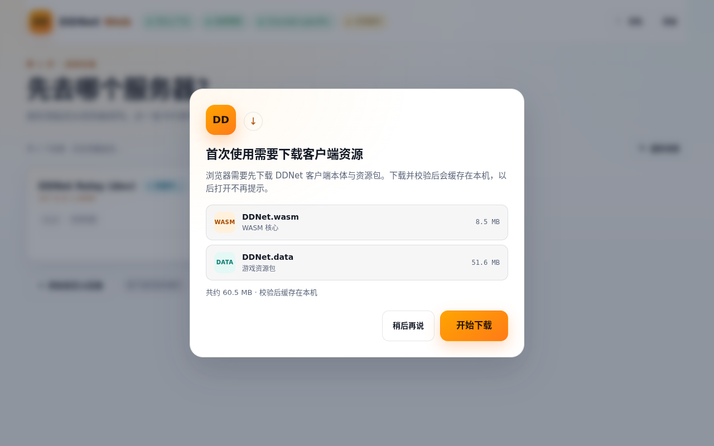
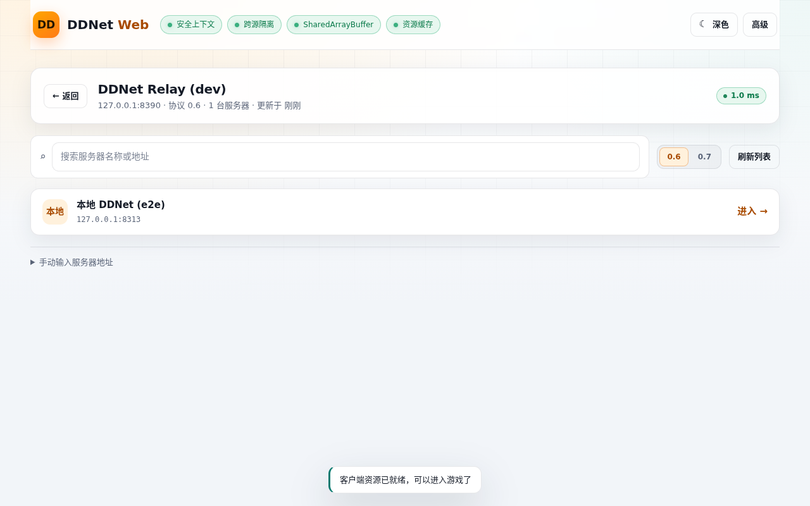
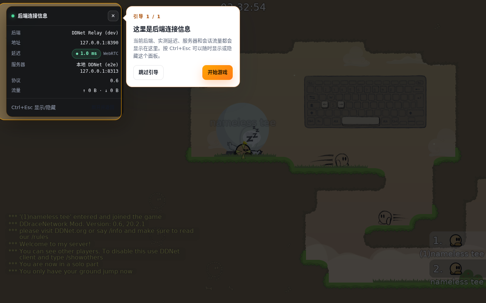

# DDNet Web 客户端 + WSS→UDP 后端节点

在浏览器里运行**真正的 DDNet 客户端**（C++ → WebAssembly），通过 `wss://` 连接自建**后端节点**，
由后端把数据报转发给任意原版 DDNet 服务器（UDP，服务器端零改动）。

三个概念：

| 层 | 本仓库 | 说明 |
|---|---|---|
| **前端** | `web/` + `ddnet-dev/`（wasm） | 浏览器里的 DDNet 客户端、资源缓存、后端/服务器列表、移动端 UI |
| **后端节点** | `relay-go/` | **Go** 实现：WebSocket ↔ UDP 中转，支持任意 UDP 游戏服务器，可单二进制/镜像部署 |
| **relay master** | `relay-go/cmd/master` | **Go** 节点注册中心：relay 注册 → master WS 首次验证 → 每 15 分钟存活检查；网页从 `/v1/serverlist` 获取节点 |
| **游戏服务器** | 不修改 | 原版 DDNet 服务器，只支持 UDP（0.6 / 0.7） |

> 技术分析与早期路线：[docs/PLAN.md](docs/PLAN.md) · **想立刻试玩：[docs/QUICKSTART.md](docs/QUICKSTART.md)**


## 界面流程（五屏）

1. **首次打开**：提示下载客户端资源（`DDNet.wasm` 8.5 MB + `DDNet.data` 51.6 MB）→ 确认后**右下角**悬浮双进度条下载 → 按 **sha256** 校验后写入浏览器 Cache Storage，之后打开不再提示。
   
2. **选择后端**：卡片列表按实测延迟升序排列（延迟测量优先 WebRTC 数据通道，失败自动回退 HTTP/WS 握手）；卡片可 ✎ 编辑 / 🗑 删除，底部"添加自定义后端"可填任意 `ws://`/`wss://` 地址与 token。右上角可切换 **亮色（默认）/ 深色** 主题。
3. **载入**：资源未就绪时中央载入页（双进度条），**可关闭**退回重选。
4. **服务器列表**：**直接读取 DDNet 官方 master（master1..4）的全部服务器**（约 1400 台，含名称/地图/类型/地区/玩家数/协议/密码房），
   支持搜索、协议/类型/地区筛选、隐藏满员/密码房、按玩家数/名称/地区排序与分页；master 不可达时回退到后端推荐列表。
   
5. **进入游戏**：首次自动**聚光灯引导**指向"后端连接信息"面板，**Ctrl + 反引号键**（`~` 键）切换显隐。
   面板新增「传输」行：**WebRTC 数据通道（首选）** / **WebSocket（回退）**。
   游戏内 DDNet 自带的服务器浏览器现在也可以**浏览并加入任意服务器**：前端启动时把后端地址注入客户端
   （`DDWeb_SetDefaultRelay`），客户端会把 `host:port` / `tw-0.7+udp://host:port` 改写成
   `<后端>/udp/<host>:<port>[?token=...&protocol=7]` 再经后端中转。
   

移动端（安卓/平板）：页面检测到触屏设备后展示**触屏操作指南**与全屏按钮，并自动给客户端加
`cl_touch_controls 1`、`cl_back_button 1`，进入游戏后使用 DDNet 内置触屏控件（左侧移动、右侧摇杆/跳跃/钩子/开火）。
桌面/非触控设备（含触屏笔记本、Windows 触控显示器/一体机）**不显示触控 UI**，并显式传入
`cl_touch_controls 0`、`cl_back_button 0`，避免 IndexedDB 里残留的移动端配置让桌面也出现触屏按钮。
触屏引导/提示关闭后会记住，刷新不再反复弹出。

---

## 架构

```
浏览器（HTTPS，COOP/COEP 已开启）
├── Web 前端 Shell（资源缓存 / 后端列表 / 服务器列表 / 状态面板 / 移动端 UI）— 原生 ESM，零构建
└── DDNet 客户端（WASM，WebGL2）
        │ net_udp_send/recv
        ▼
   websockets_emscripten.cpp（EM_JS → 浏览器 WebRTC DataChannel / WebSocket；1 消息 = 1 个 UDP 数据报）
        │ 首选：RTC DataChannel（POST /rtc/offer?target=...）
        │ 回退：ws:// 或 wss://relay/udp/<host>:<port>[?protocol=7][&token=...]
        ▼
   后端节点（Go：pion/webrtc + 自实现 RFC6455 + UDP；SSRF/鉴权/限流/统计）
        │ UDP
        ▼
   任意 DDNet 服务器 :8303（0.6 / 0.7，**无需任何修改**）

   ▲ 注册/心跳（默认 master.landmine.top，可改）
   │
relay master（Go：/v1/register、/v1/serverlist；首次注册主动 WS 探测 <relay>/ws，
             之后每 15 分钟复检，失败即移除）
```

## 目录

| 路径 | 说明 |
|---|---|
| `ddnet/` | 上游 DDNet 源码（基线，未修改） |
| `ddnet-dev/` | git worktree（分支 `web-client`），含本项目补丁 |
| `patches/ddnet-web-client.patch` | 全部 C++/CMake 补丁（可干净 apply 到上游） |
| `relay-go/` | **后端节点（Go 1.24 + pion/webrtc，依赖已 vendor）**：WebRTC 游戏传输 + WS 回退；另含 `cmd/master` 节点注册中心（`Dockerfile.master`） |
| `relay/` | 旧 Node 中继（参考实现，保留其测试用于对照） |
| `web/` | 前端站点（原生 ESM，零依赖）+ 82 项 Node 测试 + 移动端截图工具 |
| `compose.dev.yml` / `compose.test.yml` / `compose.yml` | 开发 / 测试 / 生产（全部 docker 服务走 compose） |
| `deploy/` | 生产 nginx 示例（TLS/WSS/静态站点/反代） |
| `build/` | Docker 构建流水线（emsdk 4.0.22 + rust + webasm 预编译库） |
| `dist/web/` | 部署产物（wasm + 前端 + `manifest.json`） |
| `scripts/` | `dev-up.sh`/`dev-down.sh`（compose 包装）、`assemble-web.sh`、HTTPS/WSS 开发服务器 |
| `tests/e2e/` | Puppeteer 全流程 E2E（`ux_flow.mjs`、`relay_join.mjs`、`relay_reconnect.mjs`） |

## 快速开始

```bash
cd /root/test && ./scripts/dev-up.sh        # compose：Go 后端 + 站点(http/https) + wss
# 首次运行 web-https（局域网自签证书）需要 ws：npm --prefix tests install
# 浏览器打开 http://localhost:8392/  （局域网用 https://<IP>:8443/）
# 游戏服务器默认是 DDNet 官方 Tutorial（/api/servers 列出 USA1/USA4/GER/Singapore），
# 本机不需要（也不会）启动本地游戏服务器。
# relay master：http://127.0.0.1:8391/v1/serverlist（relay 自动注册，网页自动获取）。
```

构建 / 部署：

```bash
cd build && BUILD_TYPE=Release ./build-wasm.sh   # 约 1.5 分钟，产物进 dist/web
cd .. && scripts/assemble-web.sh                 # 组装前端 + 生成 manifest.json（改前端后必须重跑）
docker compose -f compose.yml up -d --build      # 生产：Go relay + relay master（TLS/WSS 交给 nginx）
```

测试（全部通过 compose）：

```bash
docker compose -f compose.test.yml --profile test run --rm relay-unit    # Go 后端单测/集成测试
docker compose -f compose.test.yml --profile test run --rm e2e-relay     # 真实 DDNet 0.6 完整握手
docker compose -f compose.test.yml --profile test run --rm e2e-web       # Chromium 全流程 + 游戏内加入
docker compose -f compose.test.yml --profile fallback run --rm e2e-rtc-fallback # WebRTC 关闭时回退 WS
docker compose -f compose.test.yml --profile slow run --rm e2e-reconnect # 空闲断线后重连同一服务器
```

## 验证结果（实测）

| 项 | 结果 |
|---|---|
| Go 后端（WebSocket↔UDP、WebRTC↔UDP、鉴权、SSRF、限流、帧限制、优雅退出） | ✅ 79 项测试 |
| Go 后端对真实 DDNet 服务器 | ✅ `inf3` 回包 + 完整 CONNECT/ACCEPT/INFO 握手 |
| 前端 Node 测试 | ✅ 82 项 |
| Chromium E2E（下载→后端→服务器→进游戏→聚光灯→Ctrl+反引号） | ✅ 10/10 |
| 游戏内加入 + 移动/触屏 PC + WebRTC 传输 + relay master E2E（compose e2e-web 合计） | ✅ 89/89 |
| WebRTC 不可用时自动回退 WebSocket（compose fallback profile） | ✅ 4/4 |
| 延迟测量走 WebRTC DataChannel（echo 115 次 / 28 个 answer） | ✅ |
| 游戏内服务器浏览器加入（0.6 明文地址 / 0.7 sixup） | ✅ 6/6（URL 实测带 `?protocol=7`） |
| 中继空闲超时后重连同一服务器 | ✅ 4/4（客户端自动重开 WebSocket） |
| 缓存命中 / 错误面板 | ✅ 3/3 |
| 默认亮色主题 / 切换持久化 / 自定义后端增改删 | ✅ 5/5 |
| 移动端触屏 UI（手机/平板，全屏 + `cl_touch_controls`） | ✅ 截图 `web/tools/screenshots/` |
| DDNet 官方 master 全量列表 + 搜索/协议/类型/地区/满员/密码筛选 | ✅ 11/11（约 1400 台） |
| Pointer Lock / ESC 菜单光标、Tab/菜单性能、触屏 PC 隐藏触控面板 | ✅ 21/21（desktop_mode+desktop_touch） |
| wasm 中文 IME / 系统剪贴板粘贴/复制/剪切 | ✅ 11/11（ime_clipboard） |
| relay master 注册 WS 首次验证 / 失败拒绝 / 网页获取节点 | ✅ 6/6（master_discovery） |

## 协议扩展（本项目新增）

- **双传输**：浏览器先尝试 **WebRTC DataChannel**（`/rtc/offer?target=...`，UDP 语义：`ordered:false`），
  ~6 秒内未建立或信令失败则用同一 URL 自动回退 **WebSocket**；`?transport=ws` 可强制 WS
- **连接地址**：`ws[s]://relay/udp/<host>:<port>?token=...&protocol=7`
  - `protocol=7`（或 `protocol=0.7`/`sevenup=1`/`tw7=1`）→ 走 0.7（sixup）协议
- **后端 HTTP API**：`/rtc/offer` 支持延迟回显与游戏 DataChannel↔UDP 桥接；`/api/info` 返回 `rtc` 与
  `iceServers`（公网部署配 STUN/TURN，前端自动使用）
- **relay master**：
  - `POST /v1/register` `{name,url,region,version,players,transports,webrtc}`：首次注册时 master
    主动对 `<url>/ws` 做 RFC6455 握手验证，失败返回 502；验证通过后进入列表。`webrtc` 声明
    `{enabled,host,signalUrl,udpPort}`；`host` 为 WebRTC UDP 入口的域名/IP，UDP 端口是固定共享端口。
  - `GET /v1/serverlist`：只返回已验证且 healthy 的节点（CORS `*`）；节点同时声明
    `transports`（`websocket`/`webrtc`）和 `webrtc`（`signalUrl`、固定 `udpPort`）。
  - 前端默认请求同源相对路径 `/relay-master/v1/serverlist`，生产只需反代 `/relay-master/*`，
    可随时调整 master base 而不重新构建前端；也可用 `?master=` / `?masterBase=` 覆盖。
  - relay 默认 master domain `master.landmine.top`，可用 `RELAY_MASTER_DOMAIN` / `--master-domain` 修改；
    **配置了 token 的 relay 不注册**；公网 relay 必须设置 `RELAY_MASTER_ADVERTISE_URL`/`RELAY_PUBLIC_URL`。
  - master 每 15 分钟（`MASTER_PROBE_INTERVAL_MS`）用 WS 复检；失败节点立即移除。
  - TCP(WS) 与 UDP(ICE) 默认共用同一端口：dev 为 `8390`（TCP+UDP），生产为公网 `443`
    （nginx 占 TCP，relay 占 UDP）；`RTC_UDP_PORT=0` 表示跟随 relay TCP 端口，不再按用户分配 UDP 端口。
  - 生产：`MASTER_DOMAIN=master.landmine.top RELAY_PUBLIC_URL=wss://relay.example.com docker compose -f compose.yml up -d --build`
    （TLS/WSS 由生产 nginx 终止，配置见 `deploy/nginx.conf`；relay 用公网 wss 地址注册）。
- **游戏内地址改写**：前端 `Module.ccall('DDWeb_SetDefaultRelay', null, ['string','string'], [base, query])`
  - 纯 UDP 地址（`host:port` / `tw-0.7+udp://host:port`，来自 DDNet master 的服务器浏览器）会被改写成
    `<base>/udp/<host>:<port>[?<query>&protocol=7]`
- **后端 HTTP API**：`GET /healthz`、`GET /api/info`、`GET /api/servers`、`GET /api/stats`、
  `POST /rtc/offer`（WebRTC 延迟回显 / 游戏数据通道）
- **数据帧**：1 个 WebSocket 二进制帧 = 1 个 UDP 数据报（与上游服务端 lws 桥接约定一致）

## 已知限制

1. 游戏内服务器浏览器的**列表**来自 master HTTP（可用），但列表项的 **ping 仍是 UDP 语义**，浏览器里显示不出实时 ping；
   **加入**已经通过后端中转（本次修复）。
2. WebRTC 默认只用 host candidates：localhost/LAN 开箱可用；**公网部署**需要：
   放行后端 UDP 端口（compose 默认 `443/udp`，与 TCP 443 同号）、NAT 后设置 `RTC_PUBLIC_IP`、
   需要时配置 `RTC_ICE_SERVERS`（STUN/TURN，前端从 `/api/info` 读取），否则会在 ~6s 后回退 WebSocket。
3. WebRTC DataChannel 建链会增加 0.3–2s 首次连接时间；游戏内丢包/乱序由不可靠 DataChannel 承担（DDNet 可容忍）。
4. ws over TCP 有队头阻塞；WebRTC 路径已优先，后端就近部署仍推荐。
4. `.data` 资源包 51.6 MB，首次加载较慢（已做 sha256 本地缓存）。
5. 生产 compose 不再内置 TLS；需要真实域名/证书 + 生产 nginx（示例见 `deploy/nginx.conf`）。本机只做了配置校验（80/443 被其他服务占用）。
